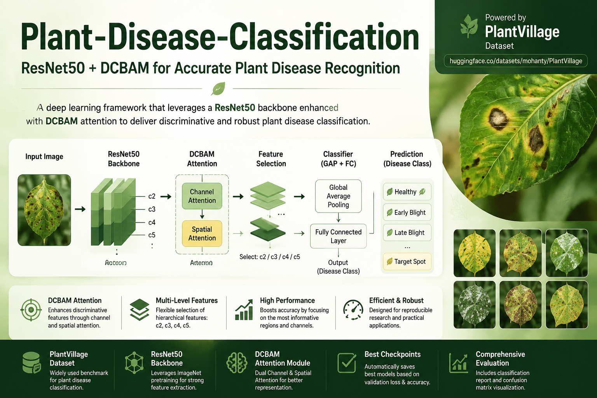

# Plant-Disease-Classification

[](https://www.python.org/)
[](https://pytorch.org/)
[](https://huggingface.co/datasets/mohanty/PlantVillage)
[](LICENSE)

**A ResNet50-DCBAM Framework for Plant Disease Classification on the PlantVillage Dataset**

------------------------------------------------------------------------

## Project Overview

This repository provides a reproducible implementation of a deep
learning framework for plant disease classification.

The project investigates an architecture based on a pretrained
**ResNet50 backbone enhanced with DCBAM (Dual Channel & Spatial
Attention Module)** for image-based plant disease recognition.

The main objective is to improve discriminative feature learning by
combining:

-   ImageNet pretrained feature extraction
-   ResNet50 hierarchical feature representation
-   Channel and spatial attention refinement using DCBAM
-   Flexible multi-level feature selection
-   Efficient classification using global average pooling

The framework is designed for controlled experiments and reproducible
research.

<p align="center">

</p>

<p align="center">
<b>Overview of the proposed ResNet50-DCBAM framework for plant disease classification.</b>
</p>

------------------------------------------------------------------------

## Key Features

-   ResNet50 backbone with pretrained ImageNet weights
-   DCBAM attention integration
    -   Channel attention
    -   Spatial attention
-   Flexible feature-level selection (`c2`, `c3`, `c4`, `c5`)
-   Official PlantVillage train/test split support
-   Deterministic, stratified train/validation splitting
-   Optional dataset integrity validation
-   Data augmentation during training
-   Automatic checkpoint management
-   Validation-based model selection:
    -   Best Validation Loss
    -   Best Validation Accuracy
-   Classification report generation
-   Normalized confusion matrix visualization
-   Experiment directory organization

------------------------------------------------------------------------

## Project Structure

``` text
Plant-Disease-Classification/
│
├── data/
│   └── PlantVillage/
│       ├── raw/
│       └── splits/
│
├── docs/
│   ├── figures/
│   │   └── architecture_overview.png
│   │
│   └── project_structure.md
│
├── experiments/
│   ├── checkpoints/
│   ├── logs/
│   ├── plots/
│   └── results/
│
├── src/
│   ├── config/
│   │   └── config.py
│   │
│   ├── datasets/
│   │   └── plant_dataset.py
│   │
│   ├── models/
│   │   ├── attention/
│   │   │   └── dcbam.py
│   │   │
│   │   ├── backbone/
│   │   │   └── resnet_dcbam.py
│   │   │
│   │   ├── classifier.py
│   │   └── plant_model.py
│   │
│   ├── training/
│   │   ├── train.py
│   │   └── test.py
│   │
│   └── utils/
│       ├── plot_logs.py
│       └── export_requirements.py
│
├── README.md
├── requirements.txt
├── LICENSE
└── .gitignore
```

------------------------------------------------------------------------

## Dataset

The project uses the official **[PlantVillage Dataset](https://huggingface.co/datasets/mohanty/PlantVillage)** training and test splits.

To prevent test-set leakage during model selection, the official
training split is further divided into training (90%) and validation
(10%) subsets using a deterministic, stratified split.

The official test split is kept separate from training, early stopping,
and checkpoint selection, and is used for final evaluation.

| Split | Images | Purpose |
|-------|-------:|---------|
| Training | 39,236 | Model training |
| Validation | 4,360 | Early stopping and checkpoint selection |
| Test | 10,709 | Final evaluation |

Dataset structure:

```text
data/
└── PlantVillage/
    ├── raw/
    │   └── color/
    └── splits/
        ├── color_train.txt
        ├── color_train_internal.txt
        ├── color_val.txt
        └── color_test.txt
```

The internal training and validation split files are generated
automatically using a fixed random seed.

Each split file contains relative image paths, for example:

```text
raw/color/Tomato___Late_blight/image_name.JPG
```

------------------------------------------------------------------------

## Installation

Clone the repository:

``` bash
git clone https://github.com/AhmadJeddi/Plant-Disease-Classification.git
cd Plant-Disease-Classification
```

Install dependencies:

``` bash
pip install -r requirements.txt
```

Recommended environment:

-   Python \>= 3.10
-   PyTorch \>= 2.5

------------------------------------------------------------------------

## Configuration

All experiments are controlled through:

    src/config/config.py

Main configurable parameters:

-   Dataset paths
-   Image size
-   Batch size
-   Learning rate
-   Training epochs
-   Weight decay
-   Early stopping patience
-   Feature extraction level
-   Pretrained backbone option
-   Experiment directories

Example:

``` python
IMAGE_SIZE = 224

FEATURE_LEVEL = "c5"

PRETRAINED = True

BATCH_SIZE = 32
```

------------------------------------------------------------------------

## Model Architecture

The proposed model consists of three main components:

    Input Image
         |
         v
    ResNet50 Backbone
         |
         +--> DCBAM Attention Refinement
         |
         v
    Feature Selection (c2/c3/c4/c5)
         |
         v
    Global Average Pooling
         |
         v
    Linear Classifier
         |
         v
    Disease Class Prediction

### ResNet50 Backbone

The backbone extracts hierarchical visual representations:

-   c2
-   c3
-   c4
-   c5

The selected feature map is passed to the classifier.

### DCBAM Attention

DCBAM improves feature representation through:

-   Channel attention:
    -   Adaptive average pooling
    -   Adaptive max pooling
    -   Shared MLP transformation
-   Spatial attention:
    -   Channel-wise average pooling
    -   Channel-wise max pooling
    -   Convolution-based spatial refinement

------------------------------------------------------------------------

## Training

Run training:

``` bash
python src/training/train.py
```

Training includes:

-   Deterministic, stratified 90/10 train-validation split
-   Optional image integrity validation before training
-   Cross Entropy Loss
-   Adam optimizer
-   Data augmentation
-   Validation-based checkpoint selection
-   Early stopping based on validation loss
-   Automatic checkpoint saving
-   Training curve visualization

Generated checkpoints:

    experiments/
    └── checkpoints/
        ├── best_loss.pth
        └── best_acc.pth

------------------------------------------------------------------------

## Evaluation

Run evaluation:

``` bash
python src/training/test.py
```

Evaluation provides:

-   Classification report
-   Precision
-   Recall
-   F1-score
-   Normalized confusion matrix
-   Saved experiment results

Results are stored in:

    experiments/
    └── results/

Visualizations:

    experiments/
    └── plots/

------------------------------------------------------------------------

## Experiments

Two checkpoints are saved based on validation performance:

- **Best Validation Loss:** Selected using the lowest validation loss.
- **Best Validation Accuracy:** Selected using the highest validation accuracy.

Both checkpoints are evaluated using the same test protocol.

------------------------------------------------------------------------

## Results

The model was evaluated on the official PlantVillage test split,
containing **10,709 images across 38 classes**, after training
with an independent validation subset.

The following results correspond to the checkpoint selected
using the lowest validation loss.

| Metric | Score |
|--------|-------|
| Accuracy | **99.65%** |
| Macro Precision | **99.37%** |
| Macro Recall | **99.58%** |
| Macro F1-score | **99.47%** |
| Weighted F1-score | **99.66%** |

These results were obtained using the revised evaluation protocol,
where the test split is not used for early stopping or checkpoint
selection.

------------------------------------------------------------------------

## Reproducibility

The project provides:

-   Fixed random seed
-   Centralized experiment configuration
-   Deterministic, stratified train/validation splitting
-   Separate test set for final evaluation
-   Consistent class mapping across dataset splits
-   Optional dataset preflight validation
-   Saved model checkpoints
-   Automated training and evaluation logging

------------------------------------------------------------------------

## Acknowledgements

This project builds upon the ResNet50-DCBAM implementation from:

**[ResNet-DCBAM](https://github.com/AhmadJeddi/Resnet-DCBAM)**

The original implementation was integrated into this framework with improved
documentation, project-specific organization, and adaptation for the Plant
Disease Classification task.

------------------------------------------------------------------------

## License

This project is licensed under the **MIT License**.

© Ahmad J. Zahed — Please keep the copyright notice and attribution when using or modifying this code.
For full details, see the [LICENSE](./LICENSE) file.
